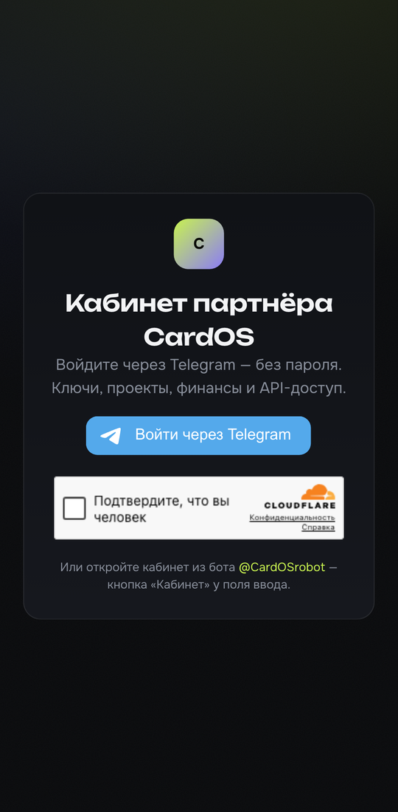

# CardOS Partner — Android app

**Кабинет партнёра [CardOS](https://cardos.dev) в телефоне.** Запускай Telegram-ботов с виртуальными картами под своим
брендом и управляй ими с Android: клиенты, выпущенные карты, оборот, заработок, баланс и выплаты.

**[⬇ Скачать APK (последняя версия)](https://github.com/CMSCardOS/cardos-app/releases/latest)** · [Сайт](https://cardos.dev) · [Документация API](https://cardos.dev/docs) · [English](#english)



## Что внутри
- Вход через Telegram — без пароля и без регистрации по почте.
- Сводка: пользователи, выпущено карт, оборот, заработано.
- Боты: запуск нового, статус и клиенты каждого бота.
- Финансы: история баланса, пополнение, выплаты, гарантийный депозит.
- Поддержка и настройки — всё, что есть в веб-кабинете.

Приложение открывает кабинет `cardos.dev/partner` на весь экран (Trusted Web Activity на движке Chrome). Обновления
кабинета появляются сразу, без переустановки.

## Установка
1. Скачай `CardOS-Partner-x.y.z.apk` из [Releases](https://github.com/CMSCardOS/cardos-app/releases/latest).
2. Открой файл на телефоне и разреши установку из этого источника.
3. Запусти **CardOS** и войди через Telegram.

Требования: Android 5.0+ и Google Chrome (или другой браузер с поддержкой TWA).

## Проверка подлинности
Ставь APK только отсюда или с [cardos.dev](https://cardos.dev). Настоящее приложение:

| | |
|---|---|
| Пакет | `dev.cardos.partner` |
| Подпись | `CN=CardOS` |
| SHA-256 сертификата | `17:36:A8:12:4E:39:80:0E:7E:4F:2D:1C:D6:03:24:FB:98:0F:18:62:C3:DB:BC:4B:36:6C:82:6F:2A:BC:8F:F6` |

Отпечаток совпадает с [`cardos.dev/.well-known/assetlinks.json`](https://cardos.dev/.well-known/assetlinks.json).
Контрольная сумма файла — рядом с APK в релизе (`.sha256`):
```bash
shasum -a 256 CardOS-Partner-1.0.0.apk
```

## Вопросы и предложения
[Issues](https://github.com/CMSCardOS/cardos-app/issues) или поддержка в кабинете.

---

## English

**The [CardOS](https://cardos.dev) partner dashboard on your phone.** Launch white-label Telegram bots with virtual
cards and manage them from Android: customers, issued cards, volume, earnings, balance and payouts.

**[⬇ Download the APK](https://github.com/CMSCardOS/cardos-app/releases/latest)** · [Website](https://cardos.dev/en) · [API docs](https://cardos.dev/en/docs)

- Sign in with Telegram — no password, no email sign-up.
- Dashboard, bots, finance (balance, top-up, payouts, security deposit), support, settings.
- Opens `cardos.dev/partner` full-screen (Trusted Web Activity on Chrome); dashboard updates arrive instantly.

**Install:** download the APK from [Releases](https://github.com/CMSCardOS/cardos-app/releases/latest), open it, allow
installs from this source, launch **CardOS**, sign in with Telegram. Requires Android 5.0+ and Chrome.

**Verify:** package `dev.cardos.partner`, signer `CN=CardOS`, certificate SHA-256 as in the table above (also published
in [`assetlinks.json`](https://cardos.dev/.well-known/assetlinks.json)). File checksum is attached to each release.

---

Source code is proprietary and not published. This repository hosts release builds only.
